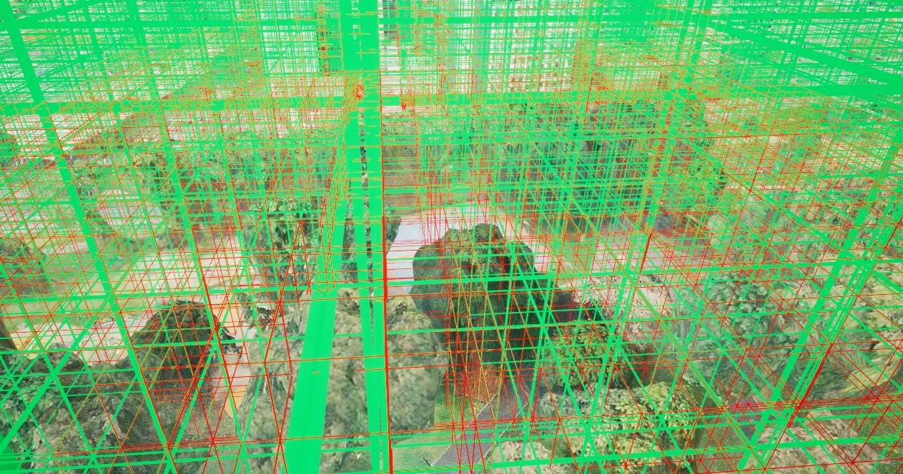

# UE5 Cesium Beidou Grid Visualizer (北斗网格可视化)

Based on Unreal Engine 5 and Cesium for Unreal, this project visualizes multi-resolution spatial grids (Beidou Grid/GeoSOT) with obstacle detection and LOD (Level of Detail).

基于 UE5 和 Cesium 插件实现的北斗多分辨率网格可视化工具。支持基于物理碰撞的建筑物剔除、视距 LOD 优化以及风场/空域属性可视化。

 *(记得把你的效果图命名为 demo.jpg 放在 Images 文件夹)*

## Features (功能)

* **Multi-Resolution (多分辨率)**: Recursively splits grids from L5 (approx 2km) down to L7 (approx 15m).
* **Obstacle Detection (障碍物剔除)**: Uses Physics Sweep to detect buildings and mark grids as Occupied or Free.
* **LOD Optimization (视距优化)**: Dynamically adjusts grid levels based on camera distance to maintain high FPS.
* **Cesium Integration**: Works seamlessly with Cesium 3D Tiles.

## How to Use (如何使用)

1.  **Dependencies**:
    * Unreal Engine 5.x
    * [Cesium for Unreal Plugin](https://www.unrealengine.com/marketplace/en-US/product/cesium-for-unreal)
2.  **Installation**:
    * Copy the `.h` and `.cpp` files from the `Source` folder to your project's C++ Source directory.
    * Regenerate Visual Studio project files and compile.
3.  **Setup in Editor**:
    * Create a Blueprint class inheriting from `AABDBasedMultiResGridVisualizer`.
    * **Critical**: Enable `Create Physics Meshes` on your Cesium3DTileset actor.
    * **Materials**: Create instances for Free (Green) and Occupied (Red) grids using the logic shown below.

## Material Setup (材质设置)

Since `.uasset` files are not included, please recreate the grid material:
*(Put your material graph screenshot here)*

## License
MIT